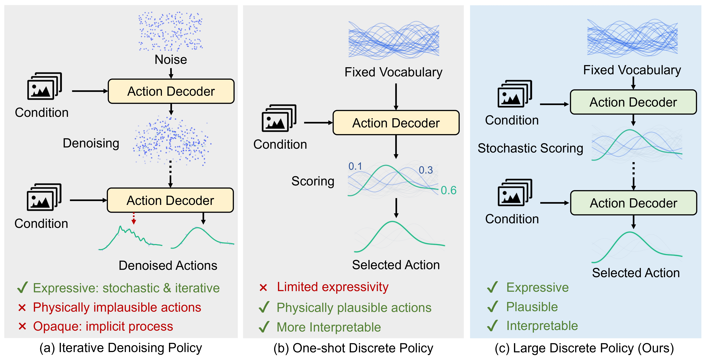

# Large Discrete Policy: Advancing Explicit Behavior Modeling with Stochastic Iterative Scoring (NeurIPS 26)



### [arXiv](https://arxiv.org/abs/2609.07049) | [Project Page](https://zhenxinli.net/LargeDiscretePolicy/)


This is the official repository of Large Discrete Policy (LDiP), a fully discrete behavior modeling framework. LDiP uses stochastic iterative scoring to select physically plausible actions for autonomous driving and robotic manipulation.
## Getting Started
Please refer to [install.md](docs/install.md) for downloading the dataset and installing the devkit.

## Model Checkpoints
| Model                                                            |                                    Resolution                                    |                                 Backbone                                  | EPDMS (Navtest) |                                    Checkpoint                                     |
|:-----------------------------------------------------------------|:--------------------------------------------------------------------------------:|:-------------------------------------------------------------------------:|:---------------:|:---------------------------------------------------------------------------------:|
| [LDiP](navsim/planning/script/config/common/agent/ldip_vov.yaml) |                   512x2048                                                       |[V2-99](https://drive.google.com/file/d/1gQkhWERCzAosBwG5bh2BKkt1k0TJZt-A/view) |      87.8       |     [Link](https://huggingface.co/Zzxxxxxxxx/LDiP/resolve/main/ldip_vov.ckpt)     |

## Training and Inference
Please refer to [ldip_training.md](docs/ldip_training.md) and [ldip_inference.md](docs/ldip_inference.md) respectively.
[simulation.md](docs/gtrs_simulation.md) provides instructions on collecting your own trajectory statistics.

## Citation
If you find our work useful, consider citing our paper with
```
@article{li2026large,
  title={Large Discrete Policy: Advancing Explicit Behavior Modeling with Stochastic Iterative Scoring},
  author={Li, Zhenxin and Chang, Nadine and Sun, Xinglong and Chen, Jingde and Yao, Wenhao and Wang, Zi and Shen, Maying and Jiang, Yu-Gang and Wu, Zuxuan and Lan, Shiyi and others},
  journal={arXiv preprint arXiv:2609.07049},
  year={2026}
}
```

## Acknowledgement
Many thanks to the following great open-source repositories:
+ [NAVSIM](https://github.com/autonomousvision/navsim)
+ [VAD](https://github.com/hustvl/VAD)
+ [Transfuser](https://github.com/autonomousvision/transfuser)